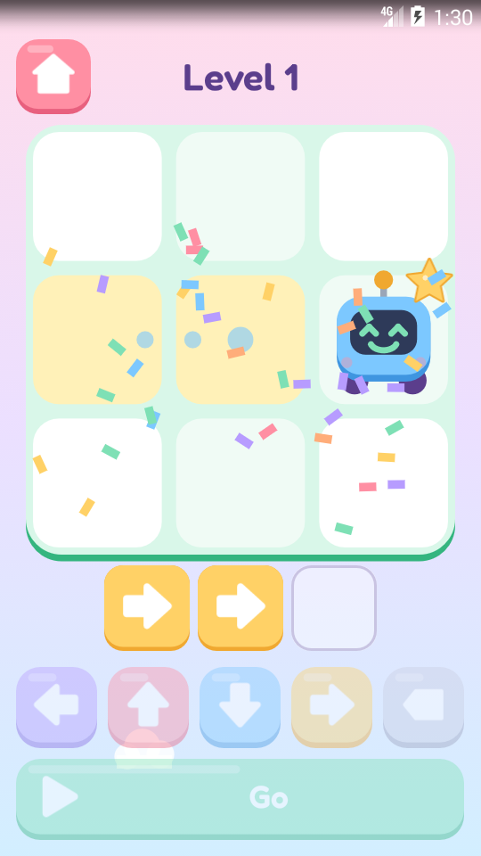
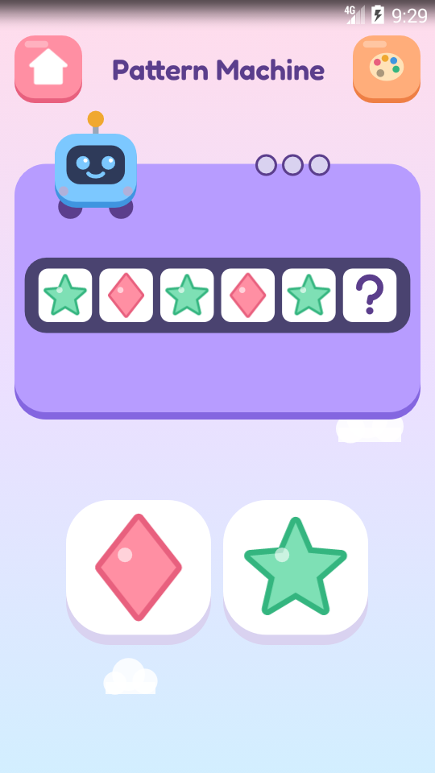
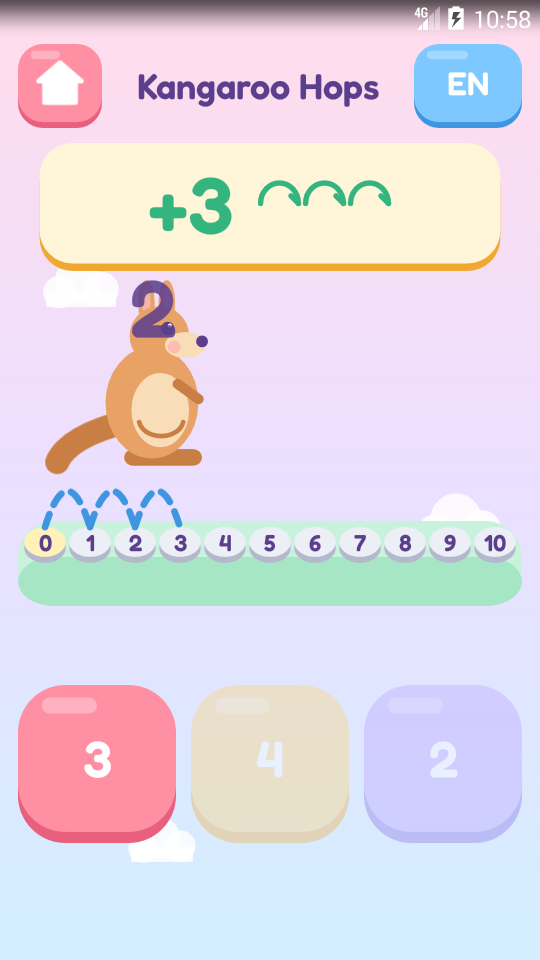
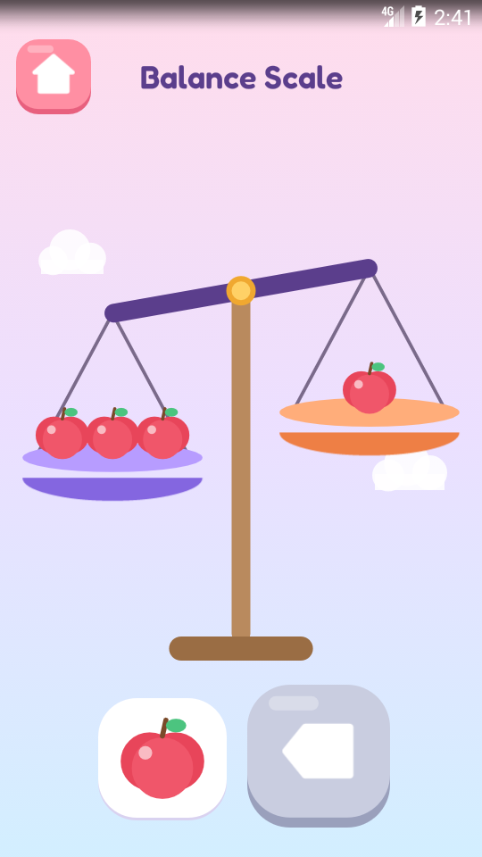

# Kids STEM Games

Four small, calm learning games for children of about 4 to 7. They were made for one curious
five-year-old growing up with three languages, to play on a 2014 phone and a tablet, and are
shared here so other children can play, learn and enjoy them too.

<p>




</p>

| Game | What she does | What it trains |
|---|---|---|
| [**Robot Path**](robot-path/) | taps arrows into a program and presses Go; the robot walks it to the star | sequencing, planning, **debugging**: fix the step that went wrong |
| [**Pattern Machine**](pattern-machine/) | finds what comes next in a row of shapes that sing; builds her own patterns | pattern recognition, the root of algebra |
| [**Kangaroo Hops**](kangaroo-hops/) | says where the kangaroo will land, then counts its hops | counting, adding, taking away, more and less, up to 20 |
| [**Balance Scale**](balance-scale/) | puts fruit on a pan until both sides weigh the same | equality, comparison, early algebra (a watermelon = three apples) |

## What they have in common

- **Made for small children.** Big pictures, big buttons (56 dp and up), and almost nothing to
  read. Feedback comes as motion, colour and sound.
- **Calm by design.** Short rounds with a clear end: a sticker, then **More!** or **Done**. No
  timers, no countdowns, no random rewards, no endless play. A wrong answer is a gentle wobble,
  never a penalty, and hints arrive after two tries.
- **Adaptive.** A round with few slips moves the child up a stage; otherwise she stays and gets
  fresh puzzles.
- **Private.** **No permissions at all**: no network, no storage, no ads, no analytics, no tracking.
  Progress stays on the device.
- **Old phones welcome.** Android 4.4 (API 19) and up, phones and tablets, portrait and landscape.
  Plain framework Views in Java with **no library dependencies**; each APK is under 100 KB.
- **Three languages.** English, Dutch and Farsi, following the device language. Kangaroo Hops can
  count aloud in any of the three, with Persian digits in Farsi.
- **Made in code.** All art (robot, kangaroo, fruit, shapes, stickers) and all sounds are drawn
  and synthesised in code. The only bundled asset is the rounded font Fredoka (SIL OFL 1.1).

They pair with [Kid Launcher](https://github.com/Foadsf/kid-launcher), a home screen for young
children that lists them on its Games page.

## Build

Each game is its own Gradle project. You need JDK 17+ and an Android SDK with
`platforms;android-35` and `build-tools;37.0.0`.

```bash
cd robot-path
```

```bash
./gradlew assembleDebug lintDebug
```

The APK lands in `app/build/outputs/apk/debug/`. `lintDebug` fails the build on any call newer than
API 19; such a call would otherwise compile and only crash on an old phone. Gradle 9.8.1
(checksum-verified) and AGP 9.4.1 are pinned.

## How they are checked

- `tools/check_logic.sh` in each game checks its puzzle generator on any JDK, without Android:
  thousands of puzzles per stage. Every answer must be offered and every level solvable, along
  with game-specific rules.
- `tools/verify.py` in each game plays it over adb on a device or emulator. It reads the game's
  state from accessibility descriptions and judges success by what the screen does, never by
  adb exit codes.
- CI runs the build, lint (API 19 gate), the logic checks, and checks that each APK targets
  minSdk 19, requests no permissions and carries the v1 signature that Android 4.4 needs.

The games were developed against API 19 emulators shaped like a Galaxy S4 mini (540×960, 240 dpi)
and a tablet (800×1280, 213 dpi).

## Licence

GPL-3.0, see [LICENSE](LICENSE). Fredoka is under the SIL Open Font License 1.1, see each game's
`licenses/` folder.
